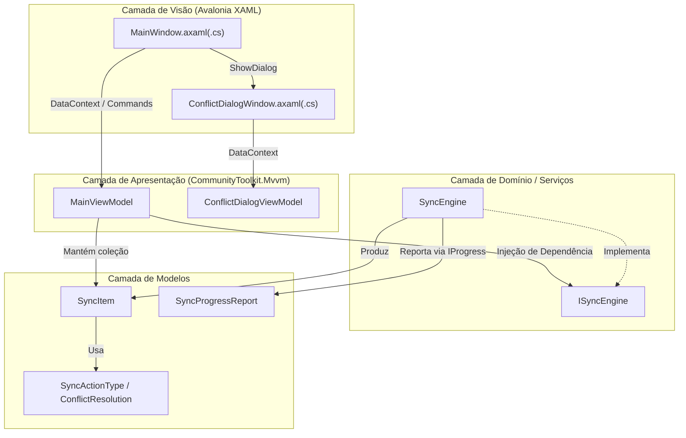

# Documentação Técnica e de Desenvolvimento — OmniSync

Este documento descreve a arquitetura de software, os algoritmos de sincronização, as decisões de engenharia para alta resiliência em rede/NAS e os procedimentos de manutenção e compilação do **OmniSync**.

---

## Índice
1. [Stack Tecnológica](#1-stack-tecnológica)
2. [Arquitetura MVVM](#2-arquitetura-mvvm)
3. [Fluxo do Motor de Sincronização (`SyncEngine`)](#3-fluxo-do-motor-de-sincronização-syncengine)
4. [Decisões de Engenharia e Resiliência](#4-decisões-de-engenharia-e-resiliência)
5. [Estrutura de Testes Automatizados](#5-estrutura-de-testes-automatizados)
6. [Compilação, Publicação e CI/CD](#6-compilação-publicação-e-cicd)

---

## 1. Stack Tecnológica

| Componente | Tecnologia / Versão | Finalidade |
| :--- | :--- | :--- |
| **Runtime & Linguagem** | .NET 10.0 / C# 13 | Performance nativa multiplataforma, `FileStream` assíncrono e `SHA256` acelerado por hardware. |
| **Interface Gráfica (UI)** | Avalonia UI `12.1.3` | Renderização Skia multiplataforma idêntica no Windows (Win32) e Linux (X11/Wayland). |
| **Controles Tabulares** | `Avalonia.Controls.DataGrid` `12.1.2` | Grade virtualizada para exibição de dezenas de milhares de arquivos. |
| **Padrão Arquitetural** | `CommunityToolkit.Mvvm` `8.4.2` | Geradores de código (`[ObservableProperty]`, `[RelayCommand]`) sem overhead de reflexão. |
| **Testes Automatizados** | `xUnit` `2.9.3` + Modo `--self-test` | Testes de integração de sistema de arquivos e teste E2E da interface gráfica. |
| **Ícones** | Geometrias vetoriais próprias (`Styles/Icons.axaml`) | Independem de fontes de emoji, ausentes em várias distribuições Linux. |

---

## 2. Arquitetura MVVM

O projeto segue separação estrita de responsabilidades segundo o padrão **Model-View-ViewModel (MVVM)**:



### Desacoplamento entre View e ViewModel
O [`MainViewModel`](../ViewModels/MainViewModel.cs) não referencia classes de janelas (`Window`) diretamente. Expõe delegates assíncronos conectados pela [`MainWindow`](../Views/MainWindow.axaml.cs) em `OnDataContextChanged`:
- `PickFolderAsync` e `PickSaveFileAsync`: seletores nativos do `IStorageProvider`.
- `AskConflictResolutionAsync`: modal [`ConflictDialogWindow`](../Views/ConflictDialogWindow.axaml.cs).
- `ConfirmSyncAsync`: janela [`ConfirmSyncWindow`](../Views/ConfirmSyncWindow.axaml) com o resumo do plano.
- `SelectTrashEntriesAsync`: janela [`RestoreWindow`](../Views/RestoreWindow.axaml) de restauração seletiva.
- `ConfirmAsync`: diálogo simples [`MessageDialog`](../Views/MessageDialog.cs) (ex.: excluir uma tarefa salva); `NotifyAsync`: aviso simples (`MessageDialog.InformAsync`).

O [`SyncEngine`](../Services/SyncEngine.cs) e o [`RestoreService`](../Services/RestoreService.cs) **não dependem do Avalonia**. O motor publica o estado de cada item por `IProgress<SyncItemUpdate>`; o ViewModel entrega essas atualizações à thread de UI em lote ([`UiBatchQueue`](../ViewModels/UiBatchQueue.cs), a cada 150 ms). Sem canal, o motor aplica o estado diretamente (uso headless e testes).

### Telas e estado
A janela principal tem quatro telas sobrepostas, cada uma visível por uma propriedade derivada do `MainViewModel`:

| Tela | Condição |
| --- | --- |
| Configuração (`IsSetupScreen`) | sem plano carregado e fora de execução/resultado |
| Plano (`IsPlanScreen`) | plano carregado, fora de execução/resultado |
| Execução (`IsRunScreen`) | `IsRunningSync` |
| Resultado (`IsResultScreen`) | `IsShowingResult` após uma execução |

- **Tarefas salvas** (no código, *profiles*): `Profiles` (`ProfileItemViewModel` sobre [`SyncProfile`](../Models/SyncProfile.cs)) e `SelectedProfile`. Trocar de tarefa copia a configuração para os campos da tela sem disparar a invalidação e descarta o plano. Cada alteração de caminho ou opção é gravada de volta na tarefa ativa; o arquivo é salvo na análise, no fim da execução, ao criar/remover tarefas e ao fechar a janela.
- **Decisões mantidas** ([`DecisionMemory`](../ViewModels/DecisionMemory.cs)): ao descartar o plano, as decisões de conflito são guardadas com tamanho e data dos dois lados; a análise seguinte da mesma origem/destino efetivo as reaplica só se nada mudou. **Alterar** não descarta o plano (`IsEditingSetup` + **Voltar ao plano**).
- **Destino efetivo**: o campo guarda a pasta escolhida; `PathHelper.ResolveEffectiveDestination` acrescenta a subpasta da origem. `SettingsService.StripSourceFolderFromDestination` migra destinos antigos que já tinham a subpasta gravada. `PathHelper.DescribePairProblem` aponta pastas iguais ou aninhadas antes da análise.
- **Busca e ordem**: [`TextSearch`](../Services/TextMatching.cs) compara sem acentos nem maiúsculas (decomposição FormD); `NaturalStringComparer` ordena números pelo valor.
- **Erros**: [`ErrorMessages`](../Services/ErrorMessages.cs) traduz códigos Win32 (HRESULT 0x8007xxxx) e errno para português; `ForLog` mantém a mensagem original no log.
- **Árvore de pastas**: [`FolderTreeBuilder`](../ViewModels/FolderTree.cs) agrega alterações (não idênticos) e conflitos por pasta. A pasta selecionada filtra a lista junto com a categoria e a busca; o caminho exibido (`SyncItem.DisplayPath`) passa a ser relativo a ela.
- **Decisões**: o painel de detalhes edita `SyncItem.Resolution` por três `RadioButton` (`IsResolutionReplace/Ignore/Ask`). O `MainViewModel` observa os conflitos e recalcula os contadores da barra inferior.
- **Execução**: contadores por fase são atualizados em `ApplyItemUpdates`, no mesmo lote que já entrega o status dos itens. Se o motor não devolver `SyncResult` (cancelamento ou erro), o balanço é reconstruído a partir do estado dos itens.
- **Janela estreita**: abaixo de 1.240 px a janela recebe a classe `compact`, e um estilo oculta a árvore de pastas.

---

## 3. Fluxo do Motor de Sincronização (`SyncEngine`)

### 3.1. Fase 1: Varredura Diferencial (`ScanDirectoriesAsync`)


### 3.2. Fase 2: Execução Física (`ExecuteSyncAsync`)

Antes da execução, o `MainViewModel` apresenta o resumo do plano (`SyncPlanSummary`) e só prossegue com a confirmação do usuário. O critério de remoção em massa (`IsMassOrphan`) é: ≥ 1.000 órfãos, ou ≥ 10 órfãos representando ≥ 20% dos arquivos do destino. Nesse caso, a confirmação exige marcação explícita.

Toda a execução ocorre em `Task.Run`. Itens idênticos ou já processados são pulados.

1. **`OrphanTrash`**: `PathHelper.MoveIntoReservedFolder` move para `<Destino>/lixo/<relPath>` sem sobrescrever (sufixo de data em colisão). Se o arquivo já não existe, o item é contado como **pulado**. Ao final, pastas que ficaram vazias são removidas com exclusão **não recursiva**.
2. **`Conflict`**: se `Resolution == AskUser`, o cronômetro de velocidade/ETA é pausado e `resolveConflictAsync` é chamado. Em `Ignore`, os bytes do item saem do total previsto. Em `Replace`, a ordem é:
   1. copiar a nova versão para `<arquivo>.omnisync-tmp`;
   2. mover a versão atual para `<Destino>/old/<relPath>`;
   3. renomear o temporário para o nome final.

   Se (2) ou (3) falhar, o temporário é removido e a versão anterior é devolvida ao lugar.
3. **`New`**: se já existir arquivo no destino (surgiu após a análise, ou difere só na caixa), o item **falha** sem sobrescrever. Caso contrário, copia para temporário e renomeia com `overwrite: false`.

A cópia (`CopyToTempWithRetryAsync`) usa buffer de 2 MB do `ArrayPool`, `FileStream` sem buffer interno (`BufferSize = 0`), `SequentialScan`, pré-alocação (`PreallocationSize`) e verificação do total de bytes contra o tamanho da origem. A data de modificação é aplicada ao temporário antes da renomeação.

O método retorna `SyncResult` (copiados, substituídos, movidos, ignorados, pulados, falhas, bytes e duração). Itens com falha ficam com `HasError = true` e `IsProcessed = false`, e podem ser reprocessados.

---

## 4. Decisões de Engenharia e Resiliência

### 4.1. Varredura (`IndexTree`)
- Pilha explícita com `FileSystemEnumerable<T>` por pasta: nome, tipo, tamanho e data vêm da própria enumeração, sem `new FileInfo()` por arquivo. Em SMB/NAS, isso elimina uma ida e volta de rede por arquivo.
- Uma única enumeração por pasta devolve arquivos e subpastas (antes eram `GetFiles` + `GetDirectories`).
- Origem e destino são indexados em paralelo.
- `IgnoreInaccessible = false` com tratamento por pasta: pastas ilegíveis são **registradas**. Arquivos do destino sob uma pasta ilegível da origem **não viram órfãos**, para que uma falha de leitura nunca leve dados válidos para `lixo/`.
- Ignorados: `$RECYCLE.BIN`, `System Volume Information`, `#recycle`, `@eaDir`, `.Trash`, `.Trash-*`, temporários `*.omnisync-tmp`, padrões de exclusão do usuário (`FileSystemName.MatchesSimpleExpression`, sem diferenciar caixa) e, na raiz, `lixo/` e `old/`. Na **origem**, `lixo/` e `old/` na raiz são ignorados **com aviso**, pois colidiriam com as pastas reservadas do destino.

### 4.2. Maiúsculas e minúsculas
`PathHelper.PathComparer` é `Ordinal` em plataformas que diferenciam caixa (Linux) e `OrdinalIgnoreCase` em Windows/macOS. No Linux:
- arquivos da origem que diferem só na caixa são itens distintos e geram aviso;
- se um arquivo da origem só encontra par no destino ignorando a caixa, e a correspondência é única nos dois lados, ele é tratado como o mesmo arquivo (cenário típico: destino em exFAT/SMB). Isso evita copiar por cima e em seguida mover a própria cópia para `lixo/`.

### 4.3. Verificação profunda (SHA-256)
Pares de mesmo tamanho são agrupados e verificados com `Parallel.ForEachAsync` (paralelismo = mín(núcleos, 4)). Em cada par, origem e destino são lidos simultaneamente (`SHA256.HashDataAsync`).

### 4.4. Verificação das cópias
Com `SyncEngine.VerifyCopies` (padrão `true`), `CopyToTempWithRetryAsync` calcula o SHA-256 da origem durante a própria leitura da cópia (`IncrementalHash`, sem leitura extra da origem), grava o temporário no disco (`Flush(flushToDisk: true)`), relê o temporário e compara os hashes antes da renomeação. Divergência gera `CopyVerificationException` (tratada como transitória: até 3 tentativas); se persistir, o item falha e o arquivo do destino permanece intacto. Custo: uma leitura adicional de cada arquivo copiado no destino.

Limitação: a releitura pode ser atendida pelo cache de disco do sistema operacional; ela detecta erros no caminho de leitura/gravação do processo, alteração da origem durante a cópia e falhas de rede/USB que corrompam o fluxo, mas não garante que o setor físico do disco foi gravado corretamente.

### 4.4. Proteção contra sincronização acidental
- **Subpasta por nome da origem** (`ResolveEffectiveDestinationPath`): `E:\Fotos` + `G:\` → `G:\Fotos`.
- **Pastas aninhadas bloqueadas**: destino dentro da origem ou origem dentro do destino lançam `InvalidOperationException`.
- **Plano invalidado**: alterar origem, destino, SHA-256, tolerância de horário de verão ou exclusões após a análise descarta o plano.
- **Confirmação** com alerta de remoção em massa (seção 3.2).

### 4.5. Retentativa
Até 3 tentativas com espera de 1 s × tentativa, **apenas para `IOException` transitória**. `FileNotFoundException`, `DirectoryNotFoundException`, `PathTooLongException`, `DriveNotFoundException` e `UnauthorizedAccessException` falham na hora.

### 4.6. Concorrência, UI e progresso
- **Status e log em lote**: `UiBatchQueue<T>` acumula em `ConcurrentQueue` e entrega à UI a cada 150 ms. Antes, cada arquivo exigia um `Dispatcher.InvokeAsync(...).GetResult()` síncrono, o principal gargalo em árvores grandes.
- **Throttling de progresso**: no máximo 1 relatório a cada 80 ms.
- **ETA**: `Math.Clamp(secondsRemaining, 0, 86400 × 30)` antes de `TimeSpan.FromSeconds`.
- **Troca atômica de `FilteredItems`** (`IReadOnlyList<SyncItem>`), com filtro por categoria e busca por caminho.

### 4.7. Restauração (`RestoreService`)
- Atua apenas em `<Destino>/lixo/` e recusa entradas fora dele.
- Restaura somente os arquivos selecionados pelo usuário.
- Nunca sobrescreve nem exclui: se o local original estiver ocupado, o arquivo permanece em `lixo/`.
- Remove o sufixo de desambiguação (`_yyyyMMdd_HHmmss[_n]`) quando o nome original está livre.
- Remove apenas pastas vazias de `lixo/`.

### 4.8. Persistência e diagnóstico
Pasta de dados por usuário (`AppPaths`): `%LOCALAPPDATA%\OmniSync` (Windows) ou `~/.local/share/OmniSync` (Linux).
- `settings.json`: tarefas salvas (`Profiles`) e tarefa ativa (`ActiveProfileId`), com gravação atômica. O formato 1.1 (uma tarefa em campos soltos) é migrado na leitura por `SettingsService.Normalize`, que também corrige ids repetidos, nomes vazios, tarefa ativa inexistente e destinos com a subpasta da origem já gravada.
- `logs/omnisync-AAAAMMDD.log`: log completo de todas as operações.
- `crash.log` e `selftest.log`.

---

## 5. Estrutura de Testes Automatizados

1. **[`Tests/SyncEngineTests.cs`](../Tests/SyncEngineTests.cs)**: classificação (novo, idêntico, órfão, conflito, SHA-256), pastas reservadas, aninhamento, nomes reservados na origem, caixa no Linux, exclusões, tolerância de horário de verão, cópia e reanálise idêntica, não sobrescrita após a análise, cancelamento sem arquivo parcial, substituição segura quando a cópia falha, órfão já removido, poda de pastas vazias e canal de atualização de itens.
2. **[`Tests/RestoreServiceTests.cs`](../Tests/RestoreServiceTests.cs)**: restauração simples, manutenção em `lixo/` quando o destino está ocupado, isolamento da `lixo/` da pasta pai, remoção do sufixo de data, preservação de `lixo/` não vazia, recusa de entradas externas e restauração seletiva.
3. **[`Tests/ModelTests.cs`](../Tests/ModelTests.cs)**: direção do conflito, mapeamento da decisão na grade, critério de remoção em massa e severidade do log.
4. **[`Tests/ProfileAndLayoutTests.cs`](../Tests/ProfileAndLayoutTests.cs)**: migração do `settings.json` 1.1, gravação e leitura das tarefas, JSON inválido, normalização, nome sugerido, estado da tarefa na barra lateral, árvore de pastas, barra proporcional e texto da ação na lista.
5. **[`Tests/SafeDecisionTests.cs`](../Tests/SafeDecisionTests.cs)**: decisões mantidas entre análises, migração do destino com subpasta gravada, destino efetivo, pastas iguais/aninhadas e confirmação das substituições de versões mais novas.
6. **[`Tests/InterfaceTests.cs`](../Tests/InterfaceTests.cs)**: busca sem acentos, ordem natural, tempos em ms, percentual limitado a 99% e concordância no resultado da restauração.
7. **[`Tests/ReportAndErrorTests.cs`](../Tests/ReportAndErrorTests.cs)**: tradução de códigos Win32/errno e formato do CSV.
8. **Autoteste E2E (`--self-test`)**: abre a janela real, executa análise e sincronização pelo `MainViewModel`, verifica o resultado em disco e grava `SELF_TEST_OK` ou `SELF_TEST_FAIL` em `selftest.log` (pasta de dados).

---

## 6. Compilação, Publicação e CI/CD

### Comandos de Publicação Local

**Windows (Executável único autossuficiente):**
```powershell
dotnet publish OmniSync.csproj -c Release -r win-x64 --self-contained true -p:PublishSingleFile=true -p:IncludeNativeLibrariesForSelfExtract=true -p:DebugType=none -o publish/win-x64
```

**Linux (Binário único autossuficiente):**
```bash
dotnet publish OmniSync.csproj -c Release -r linux-x64 --self-contained true -p:PublishSingleFile=true -p:IncludeNativeLibrariesForSelfExtract=true -p:DebugType=none -o publish/linux-x64
```

### Integração Contínua (GitHub Actions)
O arquivo [`.github/workflows/ci-release.yml`](../.github/workflows/ci-release.yml) está configurado para compilar, testar e gerar automaticamente os artefatos `OmniSync-win-x64` e `OmniSync-linux-x64` a cada *push* ou *pull request* nas branches `main`/`master`.
