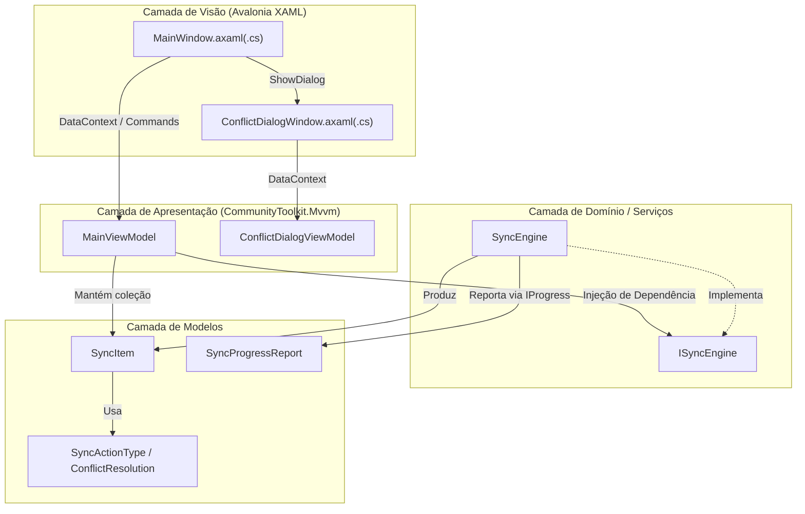
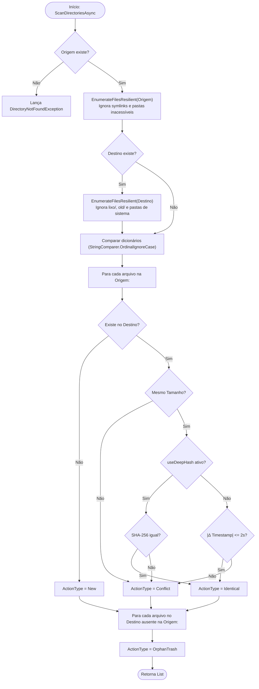

# 🛠️ Documentação Técnica e de Desenvolvimento — OmniSync

Este documento descreve a arquitetura de software, os algoritmos de sincronização, as decisões de engenharia para alta resiliência em rede/NAS e os procedimentos de manutenção e compilação do **OmniSync**.

---

## Índice
1. [Stack Tecnológica](#1-stack-tecnológica)
2. [Arquitetura MVVM](#2-arquitetura-mvvm)
3. [Fluxo do Motor de Sincronização (`SyncEngine`)](#3-fluxo-do-motor-de-sincronização-syncengine)
4. [Decisões de Engenharia e Resiliência](#4-decisões-de-engenharia-e-resiliência)
5. [Estrutura de Testes Automatizados](#5-estrutura-de-testes-automatizados)
6. [Compilação, Publicação e CI/CD](#6-compilação-publicação-e-cicd)

---

## 1. Stack Tecnológica

| Componente | Tecnologia / Versão | Finalidade |
| :--- | :--- | :--- |
| **Runtime & Linguagem** | .NET 10.0 / C# 13 | Performance nativa multiplataforma, `FileStream` assíncrono e `SHA256` acelerado por hardware. |
| **Interface Gráfica (UI)** | Avalonia UI `12.1.3` | Renderização Skia multiplataforma idêntica no Windows (Win32) e Linux (X11/Wayland). |
| **Controles Tabulares** | `Avalonia.Controls.DataGrid` `12.1.2` | Grade virtualizada para exibição de dezenas de milhares de arquivos. |
| **Padrão Arquitetural** | `CommunityToolkit.Mvvm` `8.4.2` | Geradores de código (`[ObservableProperty]`, `[RelayCommand]`) sem overhead de reflexão. |
| **Testes Automatizados** | `xUnit` `2.9.3` + Modo `--self-test` | Testes de integração de sistema de arquivos e teste E2E da interface gráfica. |

---

## 2. Arquitetura MVVM

O projeto segue separação estrita de responsabilidades segundo o padrão **Model-View-ViewModel (MVVM)**:



### Desacoplamento entre View e ViewModel
O [`MainViewModel`](../ViewModels/MainViewModel.cs) não referencia classes de janelas (`Window`) diretamente. Em vez disso, expõe dois delegates assíncronos que são conectados pela [`MainWindow`](../Views/MainWindow.axaml.cs) no evento `OnDataContextChanged`:
- `PickFolderAsync`: Encapsula o `IStorageProvider.OpenFolderPickerAsync` do sistema operacional.
- `AskConflictResolutionAsync`: Encapsula a abertura do modal [`ConflictDialogWindow`](../Views/ConflictDialogWindow.axaml.cs) via `Dispatcher.UIThread.InvokeAsync`.

Isso permite que o `MainViewModel` e o `SyncEngine` sejam testados de ponta a ponta sem depender de interação humana.

---

## 3. Fluxo do Motor de Sincronização (`SyncEngine`)

### 3.1. Fase 1: Varredura Diferencial (`ScanDirectoriesAsync`)



### 3.2. Fase 2: Execução Física (`ExecuteSyncAsync`)

Toda a execução física ocorre dentro de `Task.Run` em thread de background:

1. **Cálculo de Carga Total**: Soma os bytes de todos os itens `New` e `Conflict` para compor o denominador da barra de progresso global.
2. **Processamento de `OrphanTrash`**:
   - Move o arquivo órfão de `<Destino>/<relPath>` para `<Destino>/lixo/<relPath>` através de `MoveFileSafely`.
3. **Processamento de `Conflict`**:
   - Caso `Resolution == ConflictResolution.AskUser`, pausa o `Stopwatch` de cálculo de velocidade/ETA, solicita a decisão na UI thread via `resolveConflictAsync(item)` e retoma o `Stopwatch`.
   - Se a decisão for `Ignore`, subtrai `item.SourceSize` de `totalBytesToCopy` (via `Interlocked.Add`) para evitar que a barra de progresso termine antes de 100%.
   - Se a decisão for `Replace`, move o arquivo atual do destino para `<Destino>/old/<relPath>` e copia a nova versão da origem.
4. **Processamento de `New`**:
   - Copia o arquivo em streaming assíncrono (`BufferSize = 2 MB`) e aplica `File.SetLastWriteTimeUtc` ao final para preservar a data de modificação original.

---

## 4. Decisões de Engenharia e Resiliência

### 4.1. Varredura Resiliente a Pastas de Sistema (`EnumerateFilesResilient`)
O método padrão `Directory.EnumerateFiles(..., SearchOption.AllDirectories)` do .NET aborta toda a operação caso encontre uma única subpasta sem permissão de leitura (como `System Volume Information` ou `$RECYCLE.BIN`).
Para contornar isso, o `SyncEngine` implementa uma travessia iterativa baseada em `Stack<string>` com `EnumerationOptions`:
- `IgnoreInaccessible = true`
- `AttributesToSkip = FileAttributes.ReparsePoint` (evita loops infinitos em links simbólicos e junctions)
- Filtragem explícita de `$RECYCLE.BIN`, `System Volume Information`, `#recycle` (NAS Synology/QNAP), `.Trash` e `.Trash-1000` (Linux), além das pastas reservadas `lixo` e `old` na raiz do destino.

### 4.2. Proteção contra Sincronização Acidental na Raiz de Discos
A propriedade `UseSourceFolderNameInDestination` (ativa por padrão em [`MainViewModel.ResolveEffectiveDestinationPath`](../ViewModels/MainViewModel.cs)) garante que quando o usuário seleciona uma pasta de origem (ex.: `E:\Paglioli - Copia`) e escolhe a raiz de um disco ou pasta pai no destino (ex.: `G:\`), o caminho efetivo de destino seja automaticamente ajustado para `G:\Paglioli - Copia`. Isso impede que outras pastas pré-existentes no drive `G:\` sejam classificadas como órfãs.

### 4.3. Tratamento de Concorrência, UI Thread e Throttling
- **Throttling de Progresso**: O callback `ReportProgress` limita o envio de eventos `IProgress<SyncProgressReport>` a no máximo 1 atualização a cada **80 ms** (`Environment.TickCount64`), evitando saturação da fila de mensagens da UI durante cópias em SSDs NVMe de alta velocidade.
- **Prevenção de `OverflowException` em ETA**: O cálculo de tempo restante (`remainingBytes / bytesPerSec`) aplica `Math.Clamp(secondsRemaining, 0, 86400.0 * 30)` antes de chamar `TimeSpan.FromSeconds`, prevenindo exceções quando a taxa de transferência cai momentaneamente próxima de zero em redes Wi-Fi/NAS.
- **Substituição Atômica de `FilteredItems`**: A propriedade `FilteredItems` utiliza `IReadOnlyList<SyncItem>` em vez de adicionar itens um a um em uma `ObservableCollection`, permitindo trocar dezenas de milhares de linhas na `DataGrid` em uma única notificação de layout.

### 4.4. Colisão de Nomes nas Pastas `lixo/` e `old/`
O método `GetSafeTargetPath` verifica se já existe um arquivo com o mesmo nome dentro de `destino/lixo/` ou `destino/old/`. Caso exista, gera um nome único acrescentando o sufixo `_yyyyMMdd_HHmmss` (e contador incremental se necessário), preservando todo o histórico de versões anteriores.

---

## 5. Estrutura de Testes Automatizados

O projeto conta com duas camadas de verificação automatizada:

1. **Testes Unitários e de Integração ([`Tests/SyncEngineTests.cs`](../Tests/SyncEngineTests.cs))**:
   - `Scan_ShouldIdentifyNewFiles_WhenOnlyInSource`
   - `Scan_ShouldIdentifyIdenticalFiles_WhenSameSizeAndTime`
   - `Scan_ShouldIdentifyOrphanFiles_WhenOnlyInDestination`
   - `Scan_ShouldIgnoreLixoAndOldFoldersInDestination`
   - `Scan_ShouldDetectConflict_WhenContentDiffers`
   - `Scan_ShouldDetectConflictViaSha256_WhenSizeMatchesButHashDiffers`
   - `ExecuteSync_ShouldCopyNewFiles`
   - `ExecuteSync_ShouldMoveOrphansToLixoFolder`
   - `ExecuteSync_WhenConflictReplace_MovesOldToOldFolderAndCopiesNew`
   - `ExecuteSync_WhenConflictIgnore_KeepsDestinationIntact`

2. **Autoteste E2E da Interface Gráfica (`--self-test` em [`App.axaml.cs`](../App.axaml.cs))**:
   - Inicializa a janela real do Avalonia, cria diretórios temporários de teste, executa `ScanCommand` e `StartSyncCommand` através do `MainViewModel`, grava o resultado em `selftest.log` e encerra o processo com código `0`.

---

## 6. Compilação, Publicação e CI/CD

### Comandos de Publicação Local

**Windows (Executável único autossuficiente):**
```powershell
dotnet publish OmniSync.csproj -c Release -r win-x64 --self-contained true -p:PublishSingleFile=true -o publish/win-x64
```

**Linux (Binário único autossuficiente):**
```bash
dotnet publish OmniSync.csproj -c Release -r linux-x64 --self-contained true -p:PublishSingleFile=true -o publish/linux-x64
```

### Integração Contínua (GitHub Actions)
O arquivo [`.github/workflows/ci-release.yml`](../.github/workflows/ci-release.yml) está configurado para compilar, testar e gerar automaticamente os artefatos `OmniSync-win-x64` e `OmniSync-linux-x64` a cada *push* ou *pull request* nas branches `main`/`master`.
