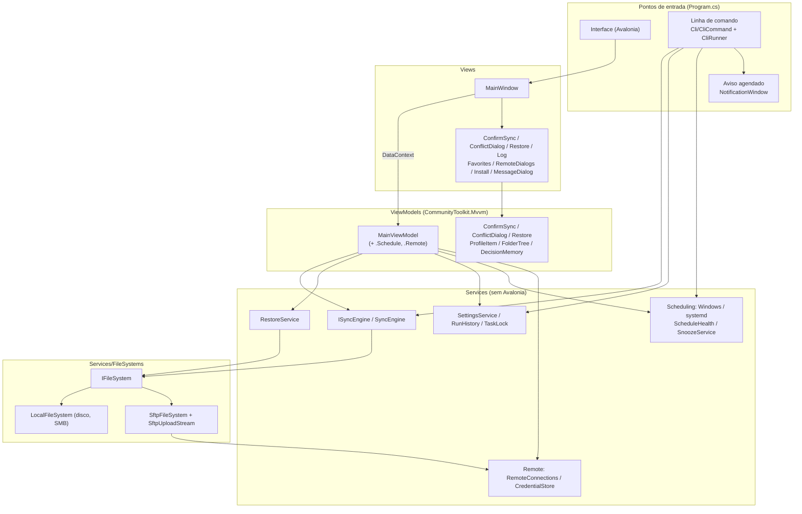
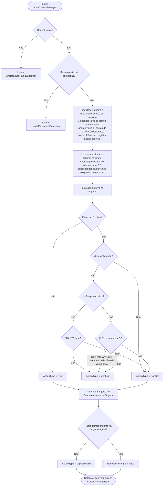

# Documentação Técnica e de Desenvolvimento — OmniSync

Este documento descreve a arquitetura de software, os algoritmos de sincronização, as decisões de engenharia para alta resiliência em rede/NAS e os procedimentos de manutenção e compilação do **OmniSync**.

---

## Índice
1. [Stack Tecnológica](#1-stack-tecnológica)
2. [Arquitetura MVVM](#2-arquitetura-mvvm)
3. [Fluxo do Motor de Sincronização (`SyncEngine`)](#3-fluxo-do-motor-de-sincronização-syncengine)
4. [Decisões de Engenharia e Resiliência](#4-decisões-de-engenharia-e-resiliência)
5. [Estrutura de Testes Automatizados](#5-estrutura-de-testes-automatizados)
6. [Compilação, Publicação e CI/CD](#6-compilação-publicação-e-cicd)

---

## 1. Stack Tecnológica

| Componente | Tecnologia / Versão | Finalidade |
| :--- | :--- | :--- |
| **Runtime & Linguagem** | .NET 10.0 / C# 14 | Performance nativa multiplataforma, `FileStream` assíncrono e `SHA256` acelerado por hardware. |
| **Interface Gráfica (UI)** | Avalonia UI `12.1.3` | Renderização Skia multiplataforma idêntica no Windows (Win32) e Linux (X11/Wayland). |
| **Controles Tabulares** | `Avalonia.Controls.DataGrid` `12.1.2` | Grade virtualizada para exibição de dezenas de milhares de arquivos. |
| **Padrão Arquitetural** | `CommunityToolkit.Mvvm` `8.4.2` | Geradores de código (`[ObservableProperty]`, `[RelayCommand]`) sem overhead de reflexão. |
| **SFTP** | `SSH.NET` `2026.0.0` (MIT) | Conexão SSH/SFTP, chave do servidor e comandos para o SHA-256 no servidor. |
| **Testes Automatizados** | `xUnit` `2.9.3` + Modo `--self-test` | Testes de integração de sistema de arquivos e teste E2E da interface gráfica. |
| **Ícones** | Geometrias vetoriais próprias (`Styles/Icons.axaml`) | Independem de fontes de emoji, ausentes em várias distribuições Linux. |

---

## 2. Arquitetura MVVM

O projeto segue separação estrita de responsabilidades segundo o padrão **Model-View-ViewModel (MVVM)**:



### Desacoplamento entre View e ViewModel
O [`MainViewModel`](../ViewModels/MainViewModel.cs) não referencia classes de janelas (`Window`) diretamente. Expõe delegates assíncronos conectados pela [`MainWindow`](../Views/MainWindow.axaml.cs) em `OnDataContextChanged`:
- `PickFolderAsync` e `PickSaveFileAsync`: seletores nativos do `IStorageProvider`.
- `AskConflictResolutionAsync`: modal [`ConflictDialogWindow`](../Views/ConflictDialogWindow.axaml.cs).
- `ConfirmSyncAsync`: janela [`ConfirmSyncWindow`](../Views/ConfirmSyncWindow.axaml) com o resumo do plano.
- `SelectTrashEntriesAsync`: janela [`RestoreWindow`](../Views/RestoreWindow.axaml) de restauração seletiva.
- `ConfirmAsync`: diálogo simples [`MessageDialog`](../Views/MessageDialog.cs) (ex.: excluir uma tarefa salva); `NotifyAsync`: aviso simples (`MessageDialog.InformAsync`).

O [`SyncEngine`](../Services/SyncEngine.cs) e o [`RestoreService`](../Services/RestoreService.cs) **não dependem do Avalonia**. O motor publica o estado de cada item por `IProgress<SyncItemUpdate>`; o ViewModel entrega essas atualizações à thread de UI em lote ([`UiBatchQueue`](../ViewModels/UiBatchQueue.cs), a cada 150 ms). Sem canal, o motor aplica o estado diretamente (uso headless e testes).

### Telas e estado
A janela principal tem quatro telas sobrepostas, cada uma visível por uma propriedade derivada do `MainViewModel`:

| Tela | Condição |
| --- | --- |
| Configuração (`IsSetupScreen`) | sem plano carregado e fora de execução/resultado |
| Plano (`IsPlanScreen`) | plano carregado, fora de execução/resultado |
| Execução (`IsRunScreen`) | `IsRunningSync` |
| Resultado (`IsResultScreen`) | `IsShowingResult` após uma execução |

- **Tarefas salvas** (no código, *profiles*): `Profiles` (`ProfileItemViewModel` sobre [`SyncProfile`](../Models/SyncProfile.cs)) e `SelectedProfile`. Trocar de tarefa copia a configuração para os campos da tela sem disparar a invalidação e descarta o plano. Cada alteração de caminho ou opção é gravada de volta na tarefa ativa; o arquivo é salvo na análise, no fim da execução, ao criar/remover tarefas e ao fechar a janela.
- **Decisões mantidas** ([`DecisionMemory`](../ViewModels/DecisionMemory.cs)): ao descartar o plano, as decisões de conflito são guardadas com tamanho e data dos dois lados; a análise seguinte da mesma origem/destino efetivo as reaplica só se nada mudou. **Alterar** não descarta o plano (`IsEditingSetup` + **Voltar ao plano**).
- **Destino efetivo**: o campo guarda a pasta escolhida; `PathHelper.ResolveEffectiveDestination` acrescenta a subpasta da origem. `SettingsService.StripSourceFolderFromDestination` migra destinos antigos que já tinham a subpasta gravada. `PathHelper.DescribePairProblem` aponta pastas iguais ou aninhadas antes da análise.
- **Busca e ordem**: [`TextSearch`](../Services/TextMatching.cs) compara sem acentos nem maiúsculas (decomposição FormD); `NaturalStringComparer` ordena números pelo valor.
- **Erros**: [`ErrorMessages`](../Services/ErrorMessages.cs) traduz códigos Win32 (HRESULT 0x8007xxxx) e errno para português; `ForLog` mantém a mensagem original no log.
- **Árvore de pastas**: [`FolderTreeBuilder`](../ViewModels/FolderTree.cs) agrega alterações (não idênticos) e conflitos por pasta. A pasta selecionada filtra a lista junto com a categoria e a busca; o caminho exibido (`SyncItem.DisplayPath`) passa a ser relativo a ela.
- **Decisões**: o painel de detalhes edita `SyncItem.Resolution` por três `RadioButton` (`IsResolutionReplace/Ignore/Ask`). O `MainViewModel` observa os conflitos e recalcula os contadores da barra inferior.
- **Execução**: contadores por fase são atualizados em `ApplyItemUpdates`, no mesmo lote que já entrega o status dos itens. Se o motor não devolver `SyncResult` (cancelamento ou erro), o balanço é reconstruído a partir do estado dos itens.
- **Janela estreita**: abaixo de 1.240 px a janela recebe a classe `compact`, e um estilo oculta a árvore de pastas.

---

## 3. Fluxo do Motor de Sincronização (`SyncEngine`)

### 3.1. Fase 1: Varredura Diferencial (`ScanDirectoriesAsync`)



### 3.2. Fase 2: Execução Física (`ExecuteSyncAsync`)

Antes da execução, o `MainViewModel` apresenta o resumo do plano (`SyncPlanSummary`) e só prossegue com a confirmação do usuário. O critério de remoção em massa (`IsMassOrphan`) é: ≥ 1.000 órfãos, ou ≥ 10 órfãos representando ≥ 20% dos arquivos do destino. Nesse caso, a confirmação exige marcação explícita.

Toda a execução ocorre em `Task.Run`. Itens idênticos ou já processados são pulados.

Os itens são processados na ordem do plano. No destino local ou SMB, um de cada vez; no destino SFTP, até `SyncEngine.RemoteCopyParallelism` (4) cópias de arquivos novos correm ao mesmo tempo, e cada ação que não pode correr junto (`lixo/`, substituição, pergunta ao usuário) espera as cópias em andamento terminarem (seção 4.12). Por tipo de item:

1. **`OrphanTrash`**: `PathHelper.MoveIntoReservedFolder` move para `<Destino>/lixo/<relPath>` sem sobrescrever (sufixo de data em colisão). Se o arquivo já não existe, o item é contado como **pulado**. Ao final, pastas que ficaram vazias são removidas com exclusão **não recursiva**.
2. **`Conflict`**: se `Resolution == AskUser`, o cronômetro de velocidade/ETA é pausado e `resolveConflictAsync` é chamado. Em `Ignore`, os bytes do item saem do total previsto. Em `Replace`, a ordem é:
   1. copiar a nova versão para `<arquivo>.omnisync-tmp`;
   2. mover a versão atual para `<Destino>/old/<relPath>`;
   3. renomear o temporário para o nome final.

   Se (2) ou (3) falhar, o temporário é removido e a versão anterior é devolvida ao lugar.
3. **`New`**: se já existir arquivo no destino (surgiu após a análise, ou difere só na caixa), o item **falha** sem sobrescrever. Caso contrário, copia para temporário e renomeia com `overwrite: false`.

A cópia (`CopyToTempWithRetryAsync`) usa buffer de 2 MB do `ArrayPool` e confere o total de bytes contra o tamanho da origem. Os fluxos vêm de `IFileSystem.OpenRead`/`CreateNew`: no `LocalFileSystem`, `FileStream` sem buffer interno (`BufferSize = 0`), `SequentialScan` e pré-alocação (`PreallocationSize`); no SFTP, `SftpUploadStream` (seção 4.12). A data de modificação é aplicada ao temporário antes da renomeação.

O método retorna `SyncResult` (copiados, substituídos, movidos, ignorados, pulados, falhas, bytes e duração). Itens com falha ficam com `HasError = true` e `IsProcessed = false`, e podem ser reprocessados.

---

## 4. Decisões de Engenharia e Resiliência

### 4.1. Varredura (`IndexTree`)
- Pilha explícita com `FileSystemEnumerable<T>` por pasta: nome, tipo, tamanho e data vêm da própria enumeração, sem `new FileInfo()` por arquivo. Em SMB/NAS, isso elimina uma ida e volta de rede por arquivo.
- Uma única enumeração por pasta devolve arquivos e subpastas (antes eram `GetFiles` + `GetDirectories`).
- Origem e destino são indexados em paralelo.
- `IgnoreInaccessible = false` com tratamento por pasta: pastas ilegíveis são **registradas**. Arquivos do destino sob uma pasta ilegível da origem **não viram órfãos**, para que uma falha de leitura nunca leve dados válidos para `lixo/`.
- Ignorados: `$RECYCLE.BIN`, `System Volume Information`, `#recycle`, `@eaDir`, `.Trash`, `.Trash-*`, temporários `*.omnisync-tmp`, padrões de exclusão do usuário (`FileSystemName.MatchesSimpleExpression`, sem diferenciar caixa) e, na raiz, `lixo/` e `old/`. Na **origem**, `lixo/` e `old/` na raiz são ignorados **com aviso**, pois colidiriam com as pastas reservadas do destino.

### 4.2. Maiúsculas e minúsculas
`PathHelper.PathComparer` é `Ordinal` em plataformas que diferenciam caixa (Linux) e `OrdinalIgnoreCase` em Windows/macOS. No Linux:
- arquivos da origem que diferem só na caixa são itens distintos e geram aviso;
- se um arquivo da origem só encontra par no destino ignorando a caixa, e a correspondência é única nos dois lados, ele é tratado como o mesmo arquivo (cenário típico: destino em exFAT/SMB). Isso evita copiar por cima e em seguida mover a própria cópia para `lixo/`.

### 4.3. Verificação profunda (SHA-256)
Pares de mesmo tamanho são agrupados e verificados com `Parallel.ForEachAsync` (paralelismo = mín(núcleos, 4)). Em cada par, origem e destino são lidos simultaneamente (`SHA256.HashDataAsync`).

### 4.4. Verificação das cópias
Com `SyncEngine.VerifyCopies` (padrão `true`), `CopyToTempWithRetryAsync` calcula o SHA-256 da origem durante a própria leitura da cópia (`IncrementalHash`, sem leitura extra da origem), relê o temporário pelo mesmo handle (sem reabrir o arquivo, o que evitaria uma segunda inspeção do antivírus) e compara os hashes antes da renomeação. Não há gravação física forçada (`FlushFileBuffers`): ela multiplicava o tempo com arquivos pequenos (medido no Linux, 20.000 arquivos: 30,5 s com flush e reabertura, 6–8 s sem; sem verificação, cerca de 4–5 s) e não acrescentava garantia, já que a releitura vem do cache. Divergência gera `CopyVerificationException` (tratada como transitória: até 3 tentativas); se persistir, o item falha e o arquivo do destino permanece intacto. Custo: uma leitura adicional de cada arquivo copiado no destino.

Limitação: a releitura é atendida pelo cache de disco do sistema operacional; ela detecta erros no caminho de leitura/gravação do processo, alteração da origem durante a cópia e falhas de rede/USB que corrompam o fluxo, mas não garante que o setor físico do disco foi gravado corretamente.

A forma de conferir vem de `IFileSystem.CopyCheck`, lida uma vez por execução: `ReadBack` (local e SMB, descrito acima), `ServerHash` (o servidor calcula o SHA-256 do temporário já fechado, por `IFileSystem.ComputeSha256OnServer`, comparado com o hash dos bytes enviados) e `Size` (só o tamanho gravado, via `GetFile`). Em `ServerHash`, resposta `null` do servidor rebaixa aquela cópia para `Size`. `SyncResult.VerifiedByHash`/`VerifiedBySize` contam cada tipo; `VerifiedBySize` vai para o log, para a tela de resultado e para o histórico (`RunRecord.VerifiedBySize`).

### 4.5. Proteção contra sincronização acidental
- **Subpasta por nome da origem** (`PathHelper.ResolveEffectiveDestination`): `E:\Fotos` + `G:\` → `G:\Fotos`.
- **Pastas aninhadas bloqueadas**: destino dentro da origem ou origem dentro do destino lançam `InvalidOperationException`.
- **Plano invalidado**: alterar origem, destino, SHA-256, tolerância de horário de verão ou exclusões após a análise descarta o plano.
- **Confirmação** com alerta de remoção em massa (seção 3.2).

### 4.6. Retentativa
Até 3 tentativas com espera de 1 s × tentativa, **apenas para `IOException` transitória**. `FileNotFoundException`, `DirectoryNotFoundException`, `PathTooLongException`, `DriveNotFoundException` e `UnauthorizedAccessException` falham na hora.

### 4.7. Concorrência, UI e progresso
- **Status e log em lote**: `UiBatchQueue<T>` acumula em `ConcurrentQueue` e entrega à UI a cada 150 ms. Antes, cada arquivo exigia um `Dispatcher.InvokeAsync(...).GetResult()` síncrono, o principal gargalo em árvores grandes.
- **Throttling de progresso**: no máximo 1 relatório a cada 80 ms.
- **ETA**: `Math.Clamp(secondsRemaining, 0, 86400 × 30)` antes de `TimeSpan.FromSeconds`.
- **Troca atômica de `FilteredItems`** (`IReadOnlyList<SyncItem>`), com filtro por categoria e busca por caminho.

### 4.8. Restauração (`RestoreService`)
- Atua apenas em `<Destino>/lixo/` e recusa entradas fora dele.
- Restaura somente os arquivos selecionados pelo usuário.
- Nunca sobrescreve nem exclui: se o local original estiver ocupado, o arquivo permanece em `lixo/`.
- Remove o sufixo de desambiguação (`_yyyyMMdd_HHmmss[_n]`) quando o nome original está livre.
- Remove apenas pastas vazias de `lixo/`.

### 4.9. Persistência e diagnóstico
Pasta de dados por usuário (`AppPaths`): `%LOCALAPPDATA%\OmniSync` (Windows) ou `~/.local/share/OmniSync` (Linux).
- `settings.json`: tarefas salvas (`Profiles`) e tarefa ativa (`ActiveProfileId`), com gravação atômica. O formato 1.1 (uma tarefa em campos soltos) é migrado na leitura por `SettingsService.Normalize`, que também corrige ids repetidos, nomes vazios, tarefa ativa inexistente e destinos com a subpasta da origem já gravada.
- `logs/omnisync-AAAAMMDD.log`: log completo de todas as operações.
- `history/<id>.json`: histórico de execuções por tarefa (seção 4.11).
- `locks/<id>.lock`: trava de execução por tarefa (seção 4.11).
- `snooze/<id>.txt`: adiamento pendente do aviso agendado (seção 4.11).
- `crash.log` e `selftest.log`.

O formato de cada arquivo está em [REFERENCIA.md](REFERENCIA.md).

### 4.10. Modo de linha de comando (`Cli/`)
`Program.Main` desvia para `RunCli` quando há qualquer argumento além de `--self-test`, antes de iniciar o Avalonia (nenhuma janela é criada).
- `CliCommand`: interpreta `--listar`, `--analisar`, `--sincronizar`, `--ajuda` (com sinônimos em inglês) e as opções `--conflitos`, `--relatorio`, `--detalhado`; argumento desconhecido gera erro e código 3.
- `CliRunner`: carrega `settings.json`, encontra a tarefa (nome sem caixa nem acentos, ou `Id`), resolve o destino efetivo com `PathHelper.ResolveEffectiveDestination`, recusa pares inválidos (`DescribePairProblem`), analisa com as opções da tarefa e aplica a política de conflitos (`ApplyConflictPolicy`: `Ignore` por padrão; `Replace` só com `origem-mais-nova` e `ConflictDirection.SourceNewer`). A proteção de remoção em massa (`SyncSafety.IsMassOrphan`, o mesmo critério da confirmação da interface) aborta antes de `ExecuteSyncAsync`. Ao fim, relê `settings.json` e grava só a última execução da tarefa.
- `ConsoleHost`: o executável Windows é `WinExe`. Se a saída padrão já está redirecionada (pipe ou arquivo), escreve nela; senão, `AttachConsole(ATTACH_PARENT_PROCESS)`. A codificação segue `GetConsoleOutputCP` (ou `GetOEMCP` sem console), via `CodePagesEncodingProvider`, para os acentos saírem certos no console e no PowerShell. Sem console nem redirecionamento (Agendador de Tarefas), a saída é descartada e fica o log diário.
- Códigos de saída: `CliExitCode` (0 sem falhas, 1 falhas, 2 remoção em massa, 3 entrada inválida, 4 interrompido, 5 erro inesperado, 6 tarefa já em execução, 7 conexão remota pendente de você, 8 servidor remoto inacessível). `RemoteAccessException` vira 7 quando `RequiresUser` e 8 nos demais casos.
- `--agendado` (`CliCommand.Scheduled`): grava o histórico como agendado e preenche `CliRunner.Notification` quando há o que avisar. `Program` então inicia o Avalonia só com a `NotificationWindow` (`App.PendingNotification`), sem a janela principal.

### 4.11. Agendamento, histórico e instalação
- **Modelo**: `SyncSchedule` (em `SyncProfile.Schedule`, dentro do `settings.json`): ligado, modo (`Sync`/`AnalyzeAndNotify`), frequência (`Daily`/`Weekly`/`AtLogon`), hora, dias, política de conflitos e `RegisteredExecutable`. `BuildArguments` usa o **id** da tarefa (renomear não quebra o agendamento).
- **Agendador do sistema** (`Services/Scheduling`): `ISystemScheduler` com `WindowsTaskScheduler` e `SystemdTimerScheduler`, escolhido em `SystemScheduler.Current`.
  - Windows: `schtasks /Create /TN \OmniSync\<id> /XML <arquivo> /F`, com XML do esquema 1.2 em UTF-16 com BOM. `InteractiveToken` + `LeastPrivilege` (sem senha nem elevação), `DisallowStartIfOnBatteries=false`, `StopIfGoingOnBatteries=false`, `StartWhenAvailable=true`, `MultipleInstancesPolicy=IgnoreNew`, limite de 72 h. Logon com `Delay=PT5M`. Saída do `schtasks` lida na página OEM.
  - Linux: `~/.config/systemd/user/omnisync-<id>.service` (oneshot) e `.timer` (`OnCalendar`, `Persistent=true`; logon como `OnStartupSec=5min`), com `daemon-reload` e `enable --now`.
  - `ScheduleHealth.Check`: executável registrado ausente ou entrada ausente no agendador. A interface verifica ao abrir e oferece registrar de novo.
- **Histórico** (`RunHistory`): `history/<id>.json` na pasta de dados, 30 registros por tarefa, gravação atômica. Fica fora do `settings.json` porque a interface aberta regrava esse arquivo inteiro. A interface grava as execuções manuais e, ao ser ativada, traz para as tarefas as execuções feitas fora dela (`RefreshRunsFromHistory`).
- **Adiar** (`SnoozeService`, botão do `NotificationWindow`): avisos de pendência, falhas ou servidor inacessível (`CliNotification.Snooze != null`) oferecem 15 min, 1 h, 4 h ou um horário no relógio (`ClockTimePicker`). O serviço registra um disparo único com os mesmos argumentos da execução que avisou: no Windows, item `\OmniSync\<id>-adiado-<AAAAMMDD-HHMMSS>` com gatilho `TimeTrigger` único (`BuildOnceXml`); no Linux, `systemd-run --user --on-calendar` (unit transitória). O estado fica em `snooze/<id>.txt` (nome do disparo e horário previsto): adiar de novo apaga o anterior, e `OnScheduledRun` cancela o pendente quando chega uma execução do agendamento normal antes do horário (folga `DueTolerance` de 1 min). Sem aviso a dar, a execução adiada termina em silêncio.
- **Trava** (`TaskLock`): `locks/<id>.lock` aberto com `FileShare.None` e `DeleteOnClose`. A sincronização pela interface e pela linha de comando a obtêm; o sistema a libera mesmo se o processo morrer.
- **Instalação** (`AppInstaller`, `ShortcutService`, `InstallWindow`): cópia para `%LOCALAPPDATA%\Programs\OmniSync` (temporário + `File.Move` com substituição), comparação por SHA-256 para detectar outra versão, atalhos `.lnk` via `WScript.Shell` (COM tardio, sem dependência de compilação) ou `.desktop` no Linux (com `omnisync.png` gravado ao lado do executável). A oferta aparece ao abrir fora da pasta fixa e ao ligar um agendamento sem instalação.


### 4.12. Camada de arquivos e SFTP (`Services/FileSystems`, `Services/Remote`)
- **`IFileSystem`**: todo acesso a arquivos do motor, da restauração e das pastas `lixo/`/`old/` passa por ela. `LocalFileSystem` repete as chamadas do `System.IO` (disco e SMB). `FileSystemProvider.For(caminho)` escolhe `SftpFileSystem` para `sftp://` e o local para o resto. O motor resolve a origem e o destino a cada análise/execução; os testes injetam sistemas fixos (ex.: `MemoryFileSystem`).
- **Caminhos**: os completos estão na notação do próprio sistema (no SFTP, o endereço canônico de `RemoteAddress`: servidor em minúsculas, porta só se ≠ 22, sem barra final). Os relativos (`SyncItem.RelativePath`) usam sempre `Path.DirectorySeparatorChar`, para comparar lados de tipos diferentes. `PathHelper.NormalizeDirectory`/`IsSubPathOf`/`ResolveEffectiveDestination` tratam endereços remotos (comparação ordinal, `/`).
- **`SftpFileSystem`** (SSH.NET 2026.0.0, MIT): converte `SftpPathNotFoundException` → `FileNotFound`/`DirectoryNotFound`, `SftpPermissionDenied` → `UnauthorizedAccess`, queda/timeout → `IOException` (repetida pelo motor), e reconecta na operação seguinte. Leituras (`ListDirectory`, atributos) repetem uma vez após `SshConnectionException`/`SocketException`, para uma queda curta não marcar pasta como ilegível. Se a reconexão falhar, `EnsureConnected` lança `RemoteAccessException` (`Unreachable`, ou `AuthenticationFailed` se a senha passou a ser recusada). `CreateNew` cria com O_EXCL (falha se existir); `MoveFile` confere o alvo antes do `rename` (nunca sobrescreve). O fluxo de gravação propaga a falha do fechamento, para um temporário incompleto nunca ser renomeado. Atalhos e arquivos especiais são ignorados na listagem.
- **Desempenho em link com latência alta (VPN, 2.0.1)**: o fluxo do `SftpClient.Open` espera a confirmação de cada pedaço (~32 KB), o que limitava a gravação a ~0,1–0,3 MB/s com ~100 ms de ida e volta. `CreateNew` sem releitura devolve `SftpUploadStream`: o motor escreve numa fila curta (2 pedaços) e uma tarefa entrega a fila ao `UploadFileAsync`, que manda os pedaços sem esperar e confere as respostas no fim; falhas (arquivo existente, permissão, queda) chegam à escrita seguinte ou ao fechamento como `IOException`, e uma queda de conexão interrompe o envio em até 0,25 s em vez de esperar o tempo-limite de 2 min. Com releitura (`VerifyByReading`), continua o fluxo do `Open`. Como o SSH.NET resolve o caminho (`realpath`) antes de cada operação, cada `stat`/`rename`/`setstat` custa duas idas e voltas: `CreateDirectory` memoriza as pastas confirmadas (esquecidas em `ForgetCachedState`, chamado pelo motor no início de cada execução, e em `DeleteEmptyDirectory`), e o motor faz até `SyncEngine.RemoteCopyParallelism` (4) cópias de arquivos novos ao mesmo tempo no destino SFTP (substituições, `lixo/` e decisões continuam uma a uma, depois das cópias em andamento). O SHA-256 no servidor roda em canais separados da mesma conexão de comandos, sem fila. Medido com `LatencyProxy` (100 ms de ida e volta): 8 MB de 27 s para 0,9 s; 40 arquivos pequenos de 117 s para ~28 s.
- **`RemoteConnections`**: uma conexão por `usuario@servidor:porta`, reaproveitada. `Get` (sem janela) usa a senha da sessão ou do cofre e só aceita chave de servidor já confirmada; `ConnectAsync` (com `IRemotePrompt`) pergunta a confirmação da chave e a senha, e grava no cofre quando o usuário pede. Senha e keyboard-interactive são oferecidos juntos (vários NAS só aceitam o segundo). Impressão digital: `HostKeyEventArgs.FingerPrintSHA256`, guardada em `AppSettings.KnownHostKeys`; chave diferente → `ChangedHostKey`, sem opção de aceitar na hora.
- **Cofre** (`CredentialStore`): Windows `CredWriteW`/`CredReadW`/`CredDeleteW` (credencial genérica `OmniSync:sftp:usuario@servidor:porta`, persistência local); Linux `secret-tool` (indisponível sem D-Bus/chaveiro). Favoritos (`AppSettings.Favorites`) guardam nome, endereço e arquivo de chave, nunca senha.
- **SHA-256 no servidor**: um `SshClient` à parte (mesmo `ConnectionInfo` e mesma impressão digital já conferida) executa comandos. Na primeira cópia da conexão, `DetectHashTool` calcula o hash de `ok` com `printf 'ok' | sha256sum` e, sem sucesso, com o PowerShell (`-EncodedCommand`, OpenSSH do Windows); só a saída com o hash certo conta, porque um usuário com `ForceCommand internal-sftp` responde vazio e com código 0. O caminho vai como dado: entre aspas simples (`'` → `'\''`) no POSIX e em Base64 UTF-16 no PowerShell (`/C:/x` → `C:/x`, `'` → `''`). Se o comando existe mas não acha o arquivo (caminho no shell diferente do SFTP, como em NAS que mostra `/pasta` no SFTP e `/volume1/pasta` no shell), a conexão passa a conferir pelo tamanho e registra o motivo no log. `RemoteFavorite.VerifyByReading` força `ReadBack`.
- **Servidor inacessível no meio da execução**: `ExecuteSyncAsync` captura `RemoteAccessException` do item atual (que falha), marca os demais como "Não executado: servidor inacessível" (sem processar, sem erro) e devolve `SyncResult.AbortReason`/`AbortRequiresUser`/`NotRun`. A poda de pastas vazias é pulada. A tela trata como interrupção ("Continuar sincronização"); a CLI grava "interrompido" no histórico e sai com 8 (ou 7, se o acesso foi recusado).
- **Temporários de execução interrompida**: `IndexTree` anota no destino os `*.omnisync-tmp` modificados há mais de `SyncEngine.StaleTempAge` (1 h) em `ScanResult.StaleTempFiles`, com aviso. `ISyncEngine.RemoveStaleTempFiles` apaga cada um antes da execução, conferindo de novo sufixo, pasta e idade. Vale para local, SMB e SFTP; a janela de revisão troca "Nenhum arquivo é excluído" pela contagem de temporários.
- **Interface**: botão **Remoto…** (menu de favoritos), `FavoritesWindow` (cadastro e Testar conexão), `HostKeyDialog`, `PasswordDialog`. A conexão é aberta antes de analisar, sincronizar e restaurar (`EnsureRemoteConnectedAsync`).
- **Testes**: `RemoteAddressTests` (endereço e caminhos), `CopyCheckAndRecoveryTests` (conferência por servidor/tamanho/releitura, temporários, parada com servidor inacessível, montagem e leitura do comando de SHA) `SftpIntegrationTests` contra um servidor real e `SftpLatencyTests` (o mesmo servidor atrás de `LatencyProxy`, um repassador TCP que atrasa 50 ms em cada sentido e derruba as conexões sob comando) (`OMNISYNC_SFTP_TEST`/`OMNISYNC_SFTP_PASSWORD`; usuário só-SFTP em `OMNISYNC_SFTP_ONLY_TEST`). No CI do Linux, um OpenSSH local na porta 2222 serve de servidor, com um segundo usuário `ForceCommand internal-sftp`, e `OMNISYNC_SFTP_REQUIRED=1` faz o teste falhar em vez de ser ignorado.

---

## 5. Estrutura de Testes Automatizados

1. **[`Tests/SyncEngineTests.cs`](../Tests/SyncEngineTests.cs)**: classificação (novo, idêntico, órfão, conflito, SHA-256), pastas reservadas, aninhamento, nomes reservados na origem, caixa no Linux, exclusões, tolerância de horário de verão, cópia e reanálise idêntica, não sobrescrita após a análise, cancelamento sem arquivo parcial, substituição segura quando a cópia falha, órfão já removido, poda de pastas vazias e canal de atualização de itens.
2. **[`Tests/RestoreServiceTests.cs`](../Tests/RestoreServiceTests.cs)**: restauração simples, manutenção em `lixo/` quando o destino está ocupado, isolamento da `lixo/` da pasta pai, remoção do sufixo de data, preservação de `lixo/` não vazia, recusa de entradas externas e restauração seletiva.
3. **[`Tests/ModelTests.cs`](../Tests/ModelTests.cs)**: direção do conflito, mapeamento da decisão na grade, critério de remoção em massa e severidade do log.
4. **[`Tests/ProfileAndLayoutTests.cs`](../Tests/ProfileAndLayoutTests.cs)**: migração do `settings.json` 1.1, gravação e leitura das tarefas, JSON inválido, normalização, nome sugerido, estado da tarefa na barra lateral, árvore de pastas, barra proporcional e texto da ação na lista.
5. **[`Tests/SafeDecisionTests.cs`](../Tests/SafeDecisionTests.cs)**: decisões mantidas entre análises, migração do destino com subpasta gravada, destino efetivo, pastas iguais/aninhadas e confirmação das substituições de versões mais novas.
6. **[`Tests/InterfaceTests.cs`](../Tests/InterfaceTests.cs)**: busca sem acentos, ordem natural, tempos em ms, percentual limitado a 99% e concordância no resultado da restauração.
7. **[`Tests/ReportAndErrorTests.cs`](../Tests/ReportAndErrorTests.cs)**: tradução de códigos Win32/errno e formato do CSV.
8. **[`Tests/CliTests.cs`](../Tests/CliTests.cs)**: argumentos (válidos e inválidos), busca da tarefa sem acentos e por id, política de conflitos (destino mais novo nunca é substituído), sincronização de ponta a ponta com CSV e registro da última execução, análise sem alterações, aborto por remoção em massa, tarefa inexistente e origem ausente.
9. **[`Tests/ScheduleTests.cs`](../Tests/ScheduleTests.cs)**: próxima execução e descrição do agendamento, argumentos reinterpretados pela CLI, persistência no `settings.json`, XML do Agendador de Tarefas (gatilhos, bateria, privilégio, ação), units do systemd (aspas e `%`), integração real com o `schtasks` (só no Windows), saúde do agendamento, histórico (limite e arquivo corrompido), trava exclusiva, execução agendada (histórico, aviso, código 6, remoção em massa), estado e cópia da instalação e entrada `.desktop`; adiamento do aviso ("Adiar"): argumentos repetidos, disparo único no XML do Agendador e no `systemd-run`, substituição e cancelamento.
10. **[`Tests/ClockPickerTests.cs`](../Tests/ClockPickerTests.cs)**: geometria do mostrador de relógio (ângulo, anel externo 00–11 e interno 12–23, minutos arredondados no clique e exatos no arraste), próxima ocorrência do horário escolhido no "Adiar" (hoje ou amanhã, virada do mês) e disparo único registrado nesse horário.
11. **[`Tests/FileSystemLayerTests.cs`](../Tests/FileSystemLayerTests.cs)**: motor e restauração sobre `MemoryFileSystem`, sem disco.
12. **[`Tests/PathProbeTests.cs`](../Tests/PathProbeTests.cs)**: tempo-limite de 5 s ao abrir pastas de rede sem resposta.
13. **[`Tests/RemoteAddressTests.cs`](../Tests/RemoteAddressTests.cs)**: interpretação e forma canônica de `sftp://`, caminhos remotos e destino efetivo remoto.
14. **[`Tests/CopyCheckAndRecoveryTests.cs`](../Tests/CopyCheckAndRecoveryTests.cs)**: conferência por servidor, tamanho e releitura; temporários de execução interrompida; parada com servidor inacessível; montagem e leitura do comando de SHA-256.
15. **[`Tests/SftpIntegrationTests.cs`](../Tests/SftpIntegrationTests.cs)** e **[`Tests/SftpLatencyTests.cs`](../Tests/SftpLatencyTests.cs)**: ponta a ponta contra um servidor SFTP real; o segundo passa pelo `LatencyProxy` (50 ms em cada sentido, queda sob comando). Sem servidor configurado, são ignorados.
16. **Autoteste E2E (`--self-test`)**: abre a janela real, executa análise e sincronização pelo `MainViewModel`, verifica o resultado em disco e grava `SELF_TEST_OK` ou `SELF_TEST_FAIL` em `selftest.log` (pasta de dados).

### Testes SFTP na máquina de desenvolvimento
Precisam de um servidor OpenSSH acessível (no Linux, o próprio `sshd` local; no Windows, o recurso opcional "Servidor OpenSSH"). Defina as variáveis e rode `dotnet test`:

```bash
export OMNISYNC_SFTP_TEST="sftp://usuario@127.0.0.1:22/home/usuario/omnisync-teste"
export OMNISYNC_SFTP_PASSWORD="senha-do-usuario"
# Opcional: usuário com ForceCommand internal-sftp, para a conferência pelo tamanho
export OMNISYNC_SFTP_ONLY_TEST="sftp://usuariosftp@127.0.0.1:22/home/usuariosftp"
# Opcional: falhar (em vez de ignorar) quando o servidor não responder
export OMNISYNC_SFTP_REQUIRED=1
dotnet test Tests/OmniSync.Tests.csproj
```

Cada teste cria uma subpasta `omnisync-teste-<aleatório>` dentro da pasta indicada e a apaga ao fim.

---

## 6. Compilação, Publicação e CI/CD

### Comandos de Publicação Local

**Windows (Executável único autossuficiente):**
```powershell
dotnet publish OmniSync.csproj -c Release -r win-x64 --self-contained true -p:PublishSingleFile=true -p:IncludeNativeLibrariesForSelfExtract=true -p:DebugType=none -o publish/win-x64
```

**Linux (Binário único autossuficiente):**
```bash
dotnet publish OmniSync.csproj -c Release -r linux-x64 --self-contained true -p:PublishSingleFile=true -p:IncludeNativeLibrariesForSelfExtract=true -p:DebugType=none -o publish/linux-x64
```

### Integração Contínua (GitHub Actions)
O arquivo [`.github/workflows/ci-release.yml`](../.github/workflows/ci-release.yml) roda em Windows e Linux a cada *push* ou *pull request* nas branches `main`/`master` e a cada tag `v*`:

1. compila a solução e roda os testes xUnit. No Linux, antes dos testes, sobe um OpenSSH local na porta 2222 com dois usuários de senha aleatória (um normal e um só-SFTP) e define `OMNISYNC_SFTP_*` com `OMNISYNC_SFTP_REQUIRED=1`, então os testes SFTP rodam de verdade;
2. publica o executável único e roda o autoteste da interface fora da pasta de build (no Linux, com `xvfb-run`);
3. testa o executável pela linha de comando: `--ajuda`, `--versao` (Linux), tarefa inexistente (código 3) e uma sincronização real (Windows), conferindo o código de saída e o arquivo copiado;
4. só em *push* (não em *pull request*), guarda os artefatos `OmniSync-win-x64` e `OmniSync-linux-x64` por 3 dias.

### Como lançar uma versão
1. Atualize `<Version>` em [`OmniSync.csproj`](../OmniSync.csproj); é o número que aparece no cabeçalho, em `--versao` e na comparação do instalador.
2. Registre as mudanças em [`CHANGELOG.md`](../CHANGELOG.md) e, se mudar o uso, no manual.
3. Abra o *pull request*; com o CI verde, faça o merge na `main`.
4. O executável oficial é o artefato do CI do *push* na `main` (baixe-o em até 3 dias). Para manter uma referência permanente, crie a tag `vX.Y.Z` no commit do merge.
